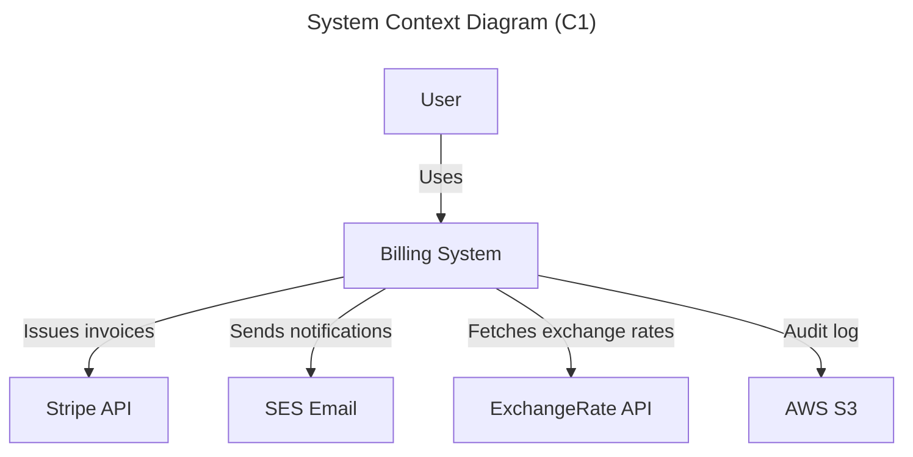
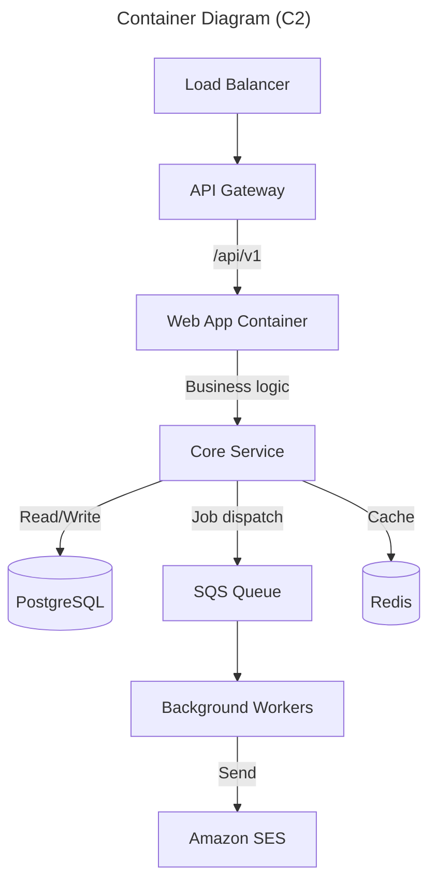

# Architecture Designer Skill

## Overview

Systematic methodology for designing, documenting, and evolving software architecture. Covers design patterns, system design methodology, architecture decision records, C4 model diagrams, and technology selection.

## 1. Design Patterns (12+ Patterns)

### Creational Patterns

| Pattern | Intent | Use When |
|---------|--------|----------|
| **Singleton** | Ensure one instance, global access | Configuration, logging, connection pools |
| **Factory Method** | Delegate object creation to subclasses | Framework code, plugin systems |
| **Abstract Factory** | Families of related objects | UI toolkits, cross-platform components |
| **Builder** | Step-by-step complex object construction | API request builders, query builders |
| **Prototype** | Clone objects instead of constructing | Object graphs with many permutations |

```python
# Builder Pattern
class QueryBuilder:
    def __init__(self):
        self._select = []
        self._from = None
        self._where = []
        self._order_by = []
        self._limit = None

    def select(self, *fields):
        self._select.extend(fields)
        return self

    def from_table(self, table: str):
        self._from = table
        return self

    def where(self, condition: str):
        self._where.append(condition)
        return self

    def order_by(self, field: str, direction: str = "ASC"):
        self._order_by.append(f"{field} {direction}")
        return self

    def limit(self, n: int):
        self._limit = n
        return self

    def build(self) -> str:
        parts = [f"SELECT {', '.join(self._select) or '*'}", f"FROM {self._from}"]
        if self._where:
            parts.append(f"WHERE {' AND '.join(self._where)}")
        if self._order_by:
            parts.append(f"ORDER BY {', '.join(self._order_by)}")
        if self._limit:
            parts.append(f"LIMIT {self._limit}")
        return ' '.join(parts)

# Usage
query = (QueryBuilder()
         .select("id", "name", "email")
         .from_table("users")
         .where("active = true")
         .where("created_at > '2024-01-01'")
         .order_by("created_at", "DESC")
         .limit(50)
         .build())
```

### Structural Patterns

| Pattern | Intent | Use When |
|---------|--------|----------|
| **Adapter** | Match incompatible interfaces | Third-party library integration |
| **Decorator** | Add behavior without modifying class | Middleware, logging, caching |
| **Facade** | Simplified interface to complex subsystem | API gateways, service wrappers |
| **Proxy** | Control access to an object | Lazy loading, access control, caching |
| **Composite** | Treat individual/group objects uniformly | Tree structures, file systems, menus |
| **Bridge** | Separate abstraction from implementation | Platform-independent rendering |

```python
# Decorator Pattern for middleware
import functools
import time

def measure_latency(func):
    """Decorator that measures function execution time."""
    @functools.wraps(func)
    async def wrapper(*args, **kwargs):
        start = time.perf_counter()
        try:
            return await func(*args, **kwargs)
        finally:
            elapsed = time.perf_counter() - start
            if elapsed > 0.1:  # 100ms threshold
                print(f"SLOW: {func.__name__} took {elapsed:.3f}s")
    return wrapper

def retry(max_retries: int = 3, delay: float = 1.0):
    """Decorator that retries on failure."""
    def decorator(func):
        @functools.wraps(func)
        async def wrapper(*args, **kwargs):
            last_exception = None
            for attempt in range(max_retries):
                try:
                    return await func(*args, **kwargs)
                except Exception as e:
                    last_exception = e
                    if attempt < max_retries - 1:
                        time.sleep(delay * (attempt + 1))
            raise last_exception
        return wrapper
    return decorator

# Usage stacking decorators
@retry(max_retries=3)
@measure_latency
async def fetch_external_data(url: str):
    ...
```

### Behavioral Patterns

| Pattern | Intent | Use When |
|---------|--------|----------|
| **Observer** | Notify multiple objects of state changes | Event systems, pub/sub, WebSockets |
| **Strategy** | Interchangeable algorithms | Payment processing, sorting, validation |
| **Command** | Encapsulate request as object | Undo/redo, job queues, transactions |
| **Chain of Responsibility** | Pass request through handler chain | Middleware pipelines, validators |
| **State** | Change behavior based on internal state | Workflow engines, game states |
| **Template Method** | Define skeleton, defer steps | CI/CD pipelines, data processing |

```python
# Strategy Pattern
from abc import ABC, abstractmethod

class PricingStrategy(ABC):
    @abstractmethod
    def calculate(self, base_price: float, quantity: int) -> float:
        pass

class VolumeDiscount(PricingStrategy):
    def calculate(self, base_price: float, quantity: int) -> float:
        if quantity >= 100:
            return base_price * quantity * 0.8  # 20% off
        elif quantity >= 10:
            return base_price * quantity * 0.9  # 10% off
        return base_price * quantity

class SeasonalDiscount(PricingStrategy):
    def __init__(self, discount_pct: float = 0.15):
        self.discount_pct = discount_pct

    def calculate(self, base_price: float, quantity: int) -> float:
        return base_price * quantity * (1 - self.discount_pct)

class LoyaltyDiscount(PricingStrategy):
    def __init__(self, tier: str):
        self.tier_multiplier = {"gold": 0.7, "silver": 0.85, "bronze": 0.95}[tier]

    def calculate(self, base_price: float, quantity: int) -> float:
        return base_price * quantity * self.tier_multiplier

class PricingContext:
    def __init__(self, strategy: PricingStrategy):
        self._strategy = strategy

    def set_strategy(self, strategy: PricingStrategy):
        self._strategy = strategy

    def calculate_total(self, base_price: float, quantity: int) -> float:
        return self._strategy.calculate(base_price, quantity)
```

### Architectural Patterns

| Pattern | Intent | Use When |
|---------|--------|----------|
| **Microservices** | Independently deployable services | Large teams, polyglot tech stacks |
| **Event-Driven** | Asynchronous communication via events | Loose coupling, real-time updates |
| **CQRS** | Separate read and write models | Complex queries, different read/write loads |
| **Event Sourcing** | Store events as source of truth | Audit trails, temporal queries |
| **Saga** | Distributed transaction coordination | Multi-service transactional workflows |
| **Strangler Fig** | Incrementally replace a legacy system | Migration without big-bang rewrite |

## 2. System Design Methodology

### Step-by-Step Process

```
┌────────────────────────────────────────────────────────────┐
│                    System Design Flow                       │
├──────────┬──────────┬───────────┬───────────┬──────────────┤
│ 1. Gather│ 2. Define│ 3. Identify│ 4. Compare│ 5. Document  │
│Requirements│Constraints│ Trade-offs │ Options  │ & Iterate   │
├──────────┼──────────┼───────────┼───────────┼──────────────┤
│ Functional│ Latency  │ Consistency│ Technology│ ADRs         │
│ Non-func  │ Scale    │ vs Avail  │ Patterns  │ Diagrams     │
│ Users     │ Budget   │ Cost vs   │ Vendor    │ RFCs         │
│ Data      │ Team size│ Speed     │ Open vs   │ Runbooks     │
│           │ Timeline │ Complexity│ Closed    │              │
└──────────┴──────────┴───────────┴───────────┴──────────────┘
```

### Requirements Gathering

```yaml
# Functional Requirements
- User can create, read, update, delete resources
- User can search with filtering and sorting
- System sends notifications on state changes
- System supports file uploads up to 100MB

# Non-Functional Requirements
latency:
  p50: < 200ms
  p95: < 500ms
  p99: < 2s
availability: 99.95%
throughput: 10,000 req/s peak
data: 50TB storage, 5TB annual growth
users: 10M MAU, 100K concurrent peak
```

### Trade-off Analysis Matrix

| Decision | Pros | Cons | Deciding Factor |
|----------|------|------|----------------|
| Monolith | Simple, fast dev, easy testing | Hard to scale teams, single deploy unit | Small team < 10 |
| Microservices | Team autonomy, independent scaling | Operational complexity, data consistency | Large team > 20 |
| SQL DB | ACID, joins, mature tooling | Vertical scaling limits | Complex relationships |
| NoSQL DB | Horizontal scaling, flexible schema | No joins, eventual consistency | High write volume |
| REST | Simple, cacheable, ubiquitous | Over-fetching, chatty | Public API, CRUD heavy |
| GraphQL | Client-defined queries, single endpoint | Complex caching, N+1 risk | Data-rich UIs |
| gRPC | Fast binary, streaming, typed | Browser unfriendly, tooling | Service-to-service |
| Event-Driven | Loose coupling, replay | Debugging difficulty, eventually | Async workflows |
| Sync | Simple to reason about | Cascading failures | Request-response |

## 3. ADR (Architecture Decision Record) Template

```markdown
---
adr: 001
title: Use PostgreSQL for Primary Data Store
status: accepted  # proposed | accepted | superseded | deprecated
date: 2024-01-15
deciders: [Alice Smith, Bob Chen]
consulted: [Carol Davis]
---

## Context

We need a primary data store for the new billing system. The system
must support complex financial queries (JOINs across invoices,
payments, customers), strong consistency for transaction records,
and full ACID compliance for audit requirements.

Options considered:
1. PostgreSQL (relational, ACID)
2. MongoDB (document, eventually consistent)
3. CockroachDB (distributed SQL)

## Decision

We will use PostgreSQL as our primary data store.

## Rationale

- Financial transactions require ACID guarantees
- Complex reporting queries benefit from PostgreSQL's JOIN support
- Mature tooling and community reduces operational risk
- JSONB columns provide flexibility for semi-structured data
- Team has strong PostgreSQL experience

## Consequences

- (+) Strong consistency guarantees for transactions
- (+) Rich query capabilities reduce application complexity
- (+) Row-level security simplifies multi-tenant isolation
- (-) Vertical scaling limits — will need read replicas at scale
- (-) Schema migrations require careful planning
- (-) Full-text search requires separate solution (add Elasticsearch)

## Compliance

- Must pass PCI DSS audit for transaction storage
- Backup/restore RPO < 1 hour, RTO < 4 hours

## Alternatives Considered

### MongoDB
- (+) Schema-less, faster iteration
- (-) No ACID transactions across documents (pre-4.0)
- (-) Eventual consistency complicates financial reconciliation
- Rejected: insufficient consistency guarantees

### CockroachDB
- (+) Horizontal scaling, distributed
- (-) Operational complexity, younger ecosystem
- (-) Higher latency for single-region queries
- Rejected: over-engineered for current scale needs
```

## 4. C4 Model Diagram Generation

### C4 Model Levels

| Level | Name | Audience | Content |
|-------|------|----------|---------|
| **C1** | System Context | Everyone | The big picture: system as a box, users, external systems |
| **C2** | Container | Developers | Services, databases, message queues, APIs |
| **C3** | Component | Engineering teams | Classes, modules, interfaces within a container |
| **C4** | Code | Individual developers | Specific classes, methods (typically auto-generated from code) |

### Diagram Templates (Mermaid)





### Structurizr DSL (for programmatic generation)

```
workspace {
    model {
        user = person "End User" "A customer using the billing portal"
        softwareSystem = softwareSystem "Billing System" "Handles invoicing and payments"

        user -> softwareSystem "Uses" "HTTPS"
    }

    views {
        systemContext softwareSystem {
            include *
            autoLayout
        }
    }
}
```

## 5. Microservices vs Monolith Analysis

### Decision Framework

```
CONSIDER MONOLITH WHEN:
- Team size < 10 developers
- Application complexity is low-medium
- Startup/early stage (need speed of iteration)
- No independent scaling requirements
- Strong data consistency required
- Single deployment unit is acceptable

CONSIDER MICROSERVICES WHEN:
- Team size > 15 developers (multiple teams)
- Different parts scale independently
- Polyglot technology per domain
- Independent deployment cycles
- Different data stores for different domains
- Organizational alignment (Conway's Law)
```

### Migration Strategy: Strangler Fig Pattern

```
1. Identify bounded contexts within monolith
2. Extract one service at a time (lowest risk first)
3. Route traffic through proxy/gateway
4. Redirect calls to new service for that domain
5. Remove old code after verification
6. Repeat for next bounded context
```

## 6. Technology Selection Framework

### Evaluation Criteria

| Criterion | Weight | Scoring |
|-----------|--------|---------|
| Team expertise | 20% | 1-5 (low to expert) |
| Community & ecosystem | 15% | 1-5 (size, activity, packages) |
| Operational maturity | 15% | 1-5 (monitoring, debugging, scaling) |
| Performance | 10% | 1-5 (benchmarks, throughput) |
| Security track record | 10% | 1-5 (CVE history, security practices) |
| License & cost | 10% | 1-5 (OSS permissive vs restrictive, pricing) |
| Roadmap & longevity | 10% | 1-5 (backed by org, recent releases) |
| Integration maturity | 10% | 1-5 (tooling, ecosystem compatibility) |

```python
# Technology scoring matrix
def score_technology(options: list[dict], weights: dict) -> list[dict]:
    """Score technology options against weighted criteria."""
    scored = []
    for opt in options:
        total = sum(opt[criterion] * weights[criterion]
                    for criterion in weights)
        scored.append({"name": opt["name"], "score": round(total, 2)})
    return sorted(scored, key=lambda x: x["score"], reverse=True)

# Example usage
weights = {
    "team_expertise": 0.20,
    "community": 0.15,
    "ops_maturity": 0.15,
    "performance": 0.10,
    "security": 0.10,
    "cost": 0.10,
    "roadmap": 0.10,
    "integration": 0.10,
}

options = [
    {"name": "PostgreSQL", "team_expertise": 5, "community": 5,
     "ops_maturity": 5, "performance": 4, "security": 5,
     "cost": 5, "roadmap": 5, "integration": 5},
    {"name": "MySQL", "team_expertise": 4, "community": 5,
     "ops_maturity": 5, "performance": 4, "security": 4,
     "cost": 5, "roadmap": 4, "integration": 5},
]

results = score_technology(options, weights)
```

## References

- [C4 Model](https://c4model.com/) — Simon Brown
- [ADR GitHub organization](https://adr.github.io/) — Architecture Decision Records
- [12 Factor App](https://12factor.net/) — Cloud-native application methodology
- [Building Evolutionary Architectures](https://www.oreilly.com/library/view/building-evolutionary-architectures/9781491986356/)
