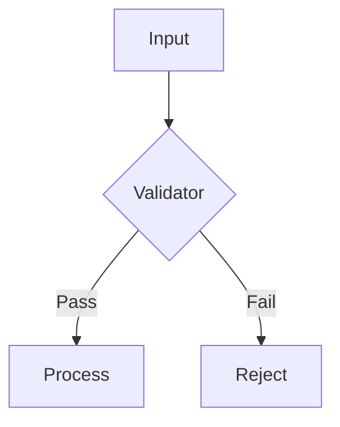

# Prompt Engineer Skill

## Overview

This skill equips AI agents with structured methodologies for crafting, testing, and iterating on prompts. It covers pattern libraries, template management, A/B testing workflows, output formatting, and optimization techniques.

---

## 1. Prompt Pattern Library

### 1.1 Persona Pattern
Assign a role to the model to ground its responses in a specific expertise, tone, or perspective.

```
Persona: You are a senior DevOps engineer with 15 years of experience in production Kubernetes.
Task: Review the following deployment manifest and identify reliability risks.
```

### 1.2 Chain-of-Thought (CoT)
Encourage step-by-step reasoning before producing a final answer.

```
Solve this problem step by step:
1. Identify the variables and constraints
2. Break the problem into sub-problems
3. Solve each sub-problem methodically
4. Combine solutions into a final answer
Problem: [problem description]
```

### 1.3 Few-Shot Pattern
Provide 2-5 exemplar input-output pairs to demonstrate desired behavior.

```
Convert natural language to SQL:

Natural: "Show me all users who signed up last month"
SQL: SELECT * FROM users WHERE created_at >= date_trunc('month', CURRENT_DATE - INTERVAL '1 month') AND created_at < date_trunc('month', CURRENT_DATE);

Natural: "What's the total revenue by product category for Q3?"
SQL: SELECT p.category, SUM(o.total) as revenue FROM orders o JOIN products p ON o.product_id = p.id WHERE o.order_date BETWEEN '2024-07-01' AND '2024-09-30' GROUP BY p.category;

Natural: "{user_input}"
SQL:
```

### 1.4 Tree-of-Thought (ToT)
Explore multiple reasoning paths simultaneously, then evaluate and converge.

```
Consider {N} distinct approaches to solve this problem. For each approach:
- Path: Outline the reasoning chain
- Pros: 2-3 advantages
- Cons: 2-3 disadvantages
- Confidence: Score 1-10

After exploring all paths, recommend the best approach with justification.
```

### 1.5 Reflexion Pattern
Have the model critique and refine its own output iteratively.

```
Generate an initial solution, then:
1. Identify weaknesses, omissions, or errors in your output
2. Explain why each issue matters
3. Produce an improved version addressing each issue
4. Repeat until no further improvements are identified
```

### 1.6 Structured Output Pattern
Force the model to follow an exact schema for machine-parseable output.

```
Respond in the following JSON schema:
{
  "summary": "string (max 100 chars)",
  "key_points": ["string (max 50 chars each)"],
  "confidence": "number between 0.0 and 1.0",
  "next_steps": ["string"]
}
Do not include any text outside the JSON object.
```

### 1.7 Decomposition Pattern
Break a complex task into subtasks, solve each independently, then compose.

```
Complex task: [task]
Subtasks:
1. [subtask 1]
2. [subtask 2]
3. [subtask 3]

Solve each subtask independently, then synthesize the results into a cohesive final output.
```

### 1.8 Negative Instruction Pattern
Specify what the model should NOT do to constrain undesirable behaviors.

```
Rules:
- Do NOT include disclaimers like "I am an AI" or "As a language model"
- Do NOT ask clarifying questions — make reasonable assumptions
- Do NOT output markdown formatting unless explicitly requested
- Do NOT list alternatives unless asked
```

### 1.9 Context-Augmented Pattern
Inject external context (documents, logs, data) and instruct the model to ground responses in it.

```
Context (documentation):
{context}

Using ONLY the context above, answer:
{question}

If the context does not contain sufficient information to answer, say "Insufficient context provided."
```

### 1.10 Meta-Prompt Pattern
Prompt the model to generate or refine prompts for a given task.

```
You are a prompt engineer. Given the following task, generate an optimized prompt that:
- Uses an appropriate pattern (persona, CoT, few-shot, etc.)
- Includes clear instructions, output format, and constraints
- Handles edge cases gracefully
- Specifies tone and verbosity level

Task: {task_description}
Generate the prompt now.
```

---

## 2. Prompt Templates Library

### Template 1: System Prompt for Code Generation
```markdown
You are an expert {language} developer. Generate production-quality code that is:
- Well-documented with docstrings
- Type-annotated where applicable
- Error-handled with meaningful messages
- Optimized for readability and performance
- Accompanied by usage examples

Constraints:
- {constraint_list}
- Follow {style_guide} conventions
- Maximum {max_lines} lines unless necessary
```

### Template 2: Analysis & Summary
```markdown
Analyze the following {content_type}:

{content}

Provide:
1. Executive summary (2-3 sentences)
2. Key findings (bullet points, prioritized by impact)
3. Supporting evidence (quotes or data points from the content)
4. Recommended actions (numbered list)
```

### Template 3: Critique & Review
```markdown
Review the following {work_product} as a {expert_role}:

{content}

Evaluate these dimensions:
- Accuracy: Are there factual errors?
- Completeness: What's missing?
- Clarity: Is the message clear?
- Actionability: Can someone act on this?
- Consistency: Does it align with stated goals?

Format as a table with Dimension | Rating (1-5) | Evidence | Recommendation.
```

### Template 4: Decision Support
```markdown
Given the following decision context:

Goal: {goal}
Options: {option_list}
Constraints: {constraint_list}
Stakeholders: {stakeholder_list}

For each option, provide:
- Feasibility score (1-10)
- Risk level (Low/Medium/High)
- Resource estimate (person-weeks)
- Expected outcome

Recommend the optimal option with rationale.
```

### Template 5: Dialogue / Conversational Agent
```markdown
You are a helpful assistant specializing in {domain}.

Conversation guidelines:
- Be concise but thorough
- Admit uncertainty when you don't know
- Ask clarifying questions if the user's intent is ambiguous
- Reference conversation history when relevant
- Offer to dive deeper on any topic

Start by greeting the user and asking how you can help with {domain} topics.
```

### Template 6: Data Extraction
```markdown
Extract structured data from the following {source_type}:

{input_text}

Extract these fields:
{field_list}

Rules:
- If a field is not found, use null
- Normalize dates to ISO 8601 (YYYY-MM-DD)
- Normalize currencies to ISO 4217 codes
- Return as a valid JSON array

Output ONLY the JSON.
```

### Template 7: Classification / Routing
```markdown
Classify the user input into exactly one of these categories:
{category_list}

Input: {user_input}

Response format:
{
  "category": "exact category name",
  "confidence": 0.0-1.0,
  "reasoning": "brief justification"
}
```

### Template 8: Comparison Matrix
```markdown
Compare the following items across the specified dimensions:

Items: {item_list}
Dimensions: {dimension_list}

Produce a markdown table with:
- Column 1: Dimension
- Columns 2..N: One column per item
- Each cell: Brief assessment
- Final row: Overall recommendation

Then provide a summary paragraph recommendation.
```

### Template 9: Learning / Tutorial
```markdown
You are a tutor explaining {topic} to a {audience_level} audience.

Structure your response as:
1. **Prerequisites** — What the learner should already know
2. **Core Concept** — Simple analogy or definition
3. **Step-by-Step Walkthrough** — Numbered steps with code/commands
4. **Common Pitfalls** — 3-5 mistakes to avoid
5. **Practice Exercise** — A task for the learner to try
6. **Next Steps** — Where to go for deeper knowledge

Use examples throughout. Avoid jargon unless defined.
```

### Template 10: Debugging / Troubleshooting
```markdown
You are debugging the following issue:

Environment: {os} {version}, {runtime} {version}
Error: {error_message}
Relevant code/logs:
{code_snippet}

Steps you've already tried:
{tried_steps}

Provide:
1. Root cause analysis (most likely cause first)
2. Verification command to confirm root cause
3. Step-by-step fix instructions
4. Prevention advice for the future
```

### Template 11: Planning / Project Breakdown
```markdown
Break down the following project into an implementation plan:

Project: {project_name}
Description: {description}
Timeline: {timeline}
Available resources: {resources}
Dependencies: {dependencies}

Output:
1. Milestones (with dates)
2. Task breakdown per milestone (owner, effort estimate)
3. Dependency graph (what blocks what)
4. Risk register (3-5 risks with mitigations)
5. Success criteria
```

### Template 12: Negotiation / Persuasion
```markdown
You are negotiating on behalf of {party} with {counterparty}. Your position is {position}, their position is {counterposition}.

Key interests: {interests}
Walk-away point: {walk_away}
Constraints: {constraints}

Draft:
1. Opening statement (acknowledge their position, state yours)
2. Value proposition (why this benefits them)
3. Concession plan (what you can offer, in order)
4. Counter-argument responses (prepare for 3 likely objections)
5. Closing strategy
```

---

## 3. A/B Testing Prompts

### Methodology
1. **Define metrics**: Accuracy, tone compliance, verbosity, format adherence, task completion
2. **Create variants**: Change one variable at a time (temperature, prompt structure, persona)
3. **Run trials**: Minimum 10 trials per variant with diverse inputs
4. **Score outputs**: Use automated scoring or LLM-as-judge
5. **Analyze results**: Statistical significance check (p < 0.05)

### A/B Test Prompt Template
```markdown
You are an impartial judge evaluating two AI responses.

Task: {task_description}

Response A:
{response_a}

Response B:
{response_b}

Evaluate each response on:
1. **Accuracy** (0-10): Freedom from errors
2. **Completeness** (0-10): Coverage of all required aspects
3. **Clarity** (0-10): Ease of understanding
4. **Conciseness** (0-10): Appropriate length without unnecessary verbosity
5. **Format Compliance** (0-10): Adherence to specified format

Provide scores and a brief justification. Declare a winner or a tie.
```

### Variable Testing Grid
| Variable | Values to Test | Impact On |
|---|---|---|
| Temperature | 0.0, 0.3, 0.7, 1.0 | Creativity vs determinism |
| System prompt length | Short (50w), Medium (200w), Long (500w) | Instruction clarity |
| Few-shot count | 0, 1, 3, 5 examples | Task comprehension |
| Persona specificity | Generic, Domain Expert, Named Role | Output quality |
| Output schema | Free text, Bullets, JSON, Markdown | Parseability |

---

## 4. Prompt Optimization Techniques

### 4.1 Token Budgeting
```
Instruction tokens   : 20% of context
Context tokens       : 60% of context
Output tokens        : 20% of context
--------------------
Total                : <= model's max context
```

### 4.2 Prefix Optimization
Place the most important instructions at the very beginning and end of the prompt (primacy/recency effects).

### 4.3 Delimiter Clarity
Use distinct delimiters for different prompt sections:
- `---` for section breaks
- `"""` for code blocks
- `>>>` for input boundaries
- `[INST]` / `[/INST]` for instruction encapsulation

### 4.4 Constraint Placement
State constraints BEFORE the task, not after. Negative instructions work best when grouped immediately after positive instructions.

### 4.5 Recursive Refinement
```markdown
For complex tasks, use a multi-pass approach:
Pass 1: Generate rough draft
Pass 2: Identify gaps and errors
Pass 3: Refine and expand
Pass 4: Final polish
```

---

## 5. Output Format Specification

### JSON Mode
```
{
  "$schema": "http://json-schema.org/draft-07/schema#",
  "type": "object",
  "properties": {
    "result": { "type": "string" },
    "confidence": { "type": "number", "minimum": 0, "maximum": 1 },
    "metadata": { "type": "object" }
  },
  "required": ["result", "confidence"]
}
```

### Markdown Table
```markdown
| Header 1 | Header 2 | Header 3 |
|---|---|---|
| Cell 1  | Cell 2  | Cell 3  |
```

### Bullet Hierarchy
```
- Level 1
  - Level 2
    - Level 3
```

### Diagram (Mermaid)


---

## 6. Evaluation Rubric

| Criterion | Weight | 1 (Poor) | 3 (Good) | 5 (Excellent) |
|---|---|---|---|---|
| Instruction Following | 30% | Misses key instructions | Follows most instructions | Perfect adherence |
| Output Quality | 25% | Factual errors | Minor inaccuracies | Accurate and insightful |
| Format Compliance | 20% | Wrong format | Format correct but messy | Clean, parseable output |
| Efficiency | 15% | Overly verbose | Appropriate length | Concise yet complete |
| Robustness | 10% | Fails on edge cases | Handles most cases | Handles all cases gracefully |

---

## 7. Workflow: End-to-End Prompt Development

```
1. REQUIREMENTS GATHERING
   - Define task objective
   - Identify target audience
   - Specify output format
   - Set constraints (length, tone, style)

2. INITIAL PROMPT CRAFTING
   - Select pattern(s) from library
   - Write system and user components
   - Define output schema

3. DRY-RUN TESTING
   - Test with 5 representative inputs
   - Check for hallucinations, omissions, format errors
   - Adjust as needed

4. A/B TESTING
   - Create 2-3 variants
   - Run 10+ trials each
   - Score and compare

5. OPTIMIZATION
   - Apply token budgeting
   - Refine instruction placement
   - Tighten constraints

6. PRODUCTION DEPLOYMENT
   - Version the prompt
   - Add monitoring / logging
   - Document in prompt registry

7. ONGOING EVALUATION
   - Periodic re-testing
   - Update as models change
   - Retire outdated prompts
```
